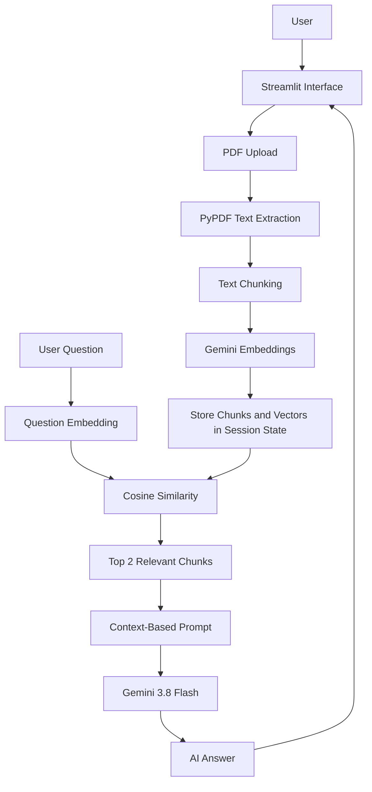

# 📄 Smart Doc-Talker — AI-Powered PDF Chatbot

Smart Doc-Talker is an AI-powered PDF question-answering application built with Python, Streamlit, LangChain text splitting, and Google Gemini.

It allows users to upload a PDF, extract its text, split the content into smaller chunks, and ask questions about the document. The application uses Gemini embeddings and cosine similarity to retrieve relevant PDF content before generating an answer with Gemini.

## 🚀 Live Demo

**Live Application:** https://zohaib001.streamlit.app

## ✨ Features

- Upload PDF documents through a Streamlit interface.
- Extract text from multi-page PDFs using PyPDF.
- Split extracted text into chunks using LangChain's RecursiveCharacterTextSplitter.
- Generate document embeddings using Google Gemini.
- Convert user questions into embeddings.
- Retrieve the two most relevant chunks using cosine similarity.
- Generate PDF-grounded answers using Gemini 3.8 Flash.
- Maintain chat messages during the current Streamlit session.
- Clear chat history using the Clear Chat button.
- Detect PDF changes and clear previous document data.
- Validate empty, oversized, password-protected, and unreadable PDFs.
- Retry Gemini requests when temporary 503/UNAVAILABLE errors occur.

## 🧠 How It Works

1. The user uploads a PDF.
2. PyPDF extracts text from its pages.
3. The extracted text is divided into chunks of 500 characters with 50 characters of overlap.
4. Google Gemini generates an embedding vector for each chunk.
5. The user submits a question.
6. Gemini converts the question into an embedding.
7. Python calculates cosine similarity between the question vector and document chunk vectors.
8. The application selects the top two most relevant chunks.
9. These chunks and the user's question are included in a prompt.
10. Gemini 3.8 Flash generates an answer using the retrieved PDF context.

## 🏗️ Architecture



## 🛠️ Tech Stack

| Technology | Purpose |
|---|---|
| Python | Application logic |
| Streamlit | Web interface |
| PyPDF | PDF text extraction |
| LangChain Text Splitters | Text chunking |
| Google Gemini Embeddings | Text and question embeddings |
| Google Gemini 3.8 Flash | Answer generation |
| Python Cosine Similarity | Semantic retrieval |
| python-dotenv | Local environment variable management |

## 📂 Project File

```text
python-100-days/
│
├── day39_streamlit_app.py
├── requirements.txt
├── README.md
└── .gitignore
```

## ⚙️ Installation and Setup

### 1. Clone the repository

```bash
git clone https://github.com/Zohaib-AiEngineering/python-100-days.git
cd python-100-days
```

### 2. Create and activate a virtual environment

```bash
python -m venv .venv
```

Windows:

```bash
.venv\Scripts\activate
```

### 3. Install dependencies

```bash
pip install -r requirements.txt
```

### 4. Configure the Gemini API key

Create a `.env` file in the project root:

```env
GEMINI_API_KEY=your_actual_gemini_api_key
```

Keep this file private. Never commit your actual API key to GitHub.

### 5. Run the application

```bash
streamlit run day39_streamlit_app.py
```

## ☁️ Deployment

The application is deployed using Streamlit Community Cloud.

Live URL: https://zohaib001.streamlit.app

The application requires a valid Gemini API key configured in its deployment environment.

## ⚠️ Current Limitations

- The application processes PDFs with extractable text; OCR for scanned PDFs is not implemented.
- Maximum accepted PDF size is 10 MB.
- Password-protected PDFs are rejected.
- Only the two highest-scoring chunks are passed to the LLM.
- Chunk embeddings and chat messages are held in Streamlit session state; there is no persistent vector database.
- Chat messages are displayed from session state, but previous conversation messages are not included in the current question's Gemini prompt.
- Answers depend on the relevance and quality of retrieved PDF chunks.

## 🔮 Future Improvements

- Add persistent vector storage.
- Support multiple PDFs in one conversation.
- Add OCR for scanned documents.
- Add source page references and citations.
- Improve retrieval with configurable top-k results.
- Add conversation-aware prompting.
- Add evaluation for retrieval quality and answer groundedness.

## 👨‍💻 Project Background

Built as part of a practical AI Engineering learning journey, covering Python, embeddings, semantic search, RAG concepts, LangChain, Gemini API integration, Streamlit, and cloud deployment.
